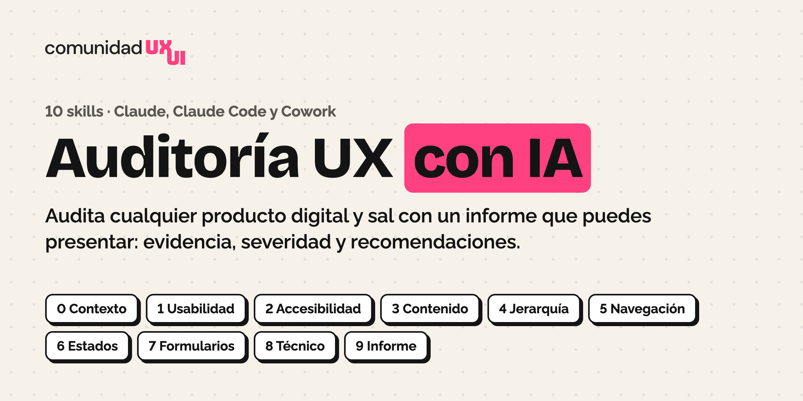
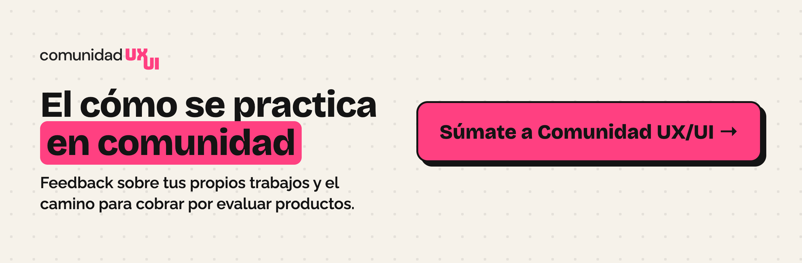
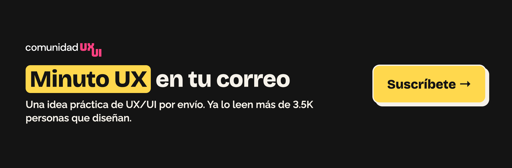

<p align="center"></p>

# Auditoría UX con IA

**10 skills para auditar cualquier producto digital (web, móvil o de escritorio) con la ayuda de una IA, y salir con un informe que puedes presentar:** cada problema con su prueba, una prioridad con criterio, conclusiones y recomendaciones.

[](LICENSE)
[](skills/)
[](#en-claude-code)
[](#)

---

## Por qué esto y no «audita mi web» a secas

Si le pides eso a una IA sin darle un método, te devuelve una lista de consejos que valdrían para cualquier sitio, y algunos inventados. Este stack le enseña a trabajar con el rigor de una persona auditora profesional:

- **Cada problema trae su prueba.** Todo lo que entra al informe se apoya en algo observado en pantalla y capturado en ese momento. Lo que queda en duda se marca como pendiente de comprobar.
- **Prioridades con criterio.** Una escala del 0 al 4 con ejemplos de referencia, una regla para los problemas que aparecen solo a veces y una señal de alarma para cuando todo empieza a parecer urgente.
- **Entra todo lo que aparece.** La cantidad de problemas nunca se limita. Los más leves se agrupan al final, para que los importantes se lean primero.
- **Pide permiso antes de actuar.** Los límites se acuerdan antes de empezar, y cualquier acción con consecuencias reales (un pago, una publicación, un envío) espera tu confirmación.
- **Un informe que se puede presentar.** Está escrito para alguien que no participó de la auditoría: tu cliente, tu equipo o tu jefatura.

## Así se ve el resultado

Un fragmento del [informe de ejemplo](docs/ejemplo-de-informe.md), hecho con este stack sobre TurnoYa, una app inventada para reservar turnos médicos:

| ID | Hallazgo | Evidencia | Severidad |
|---|---|---|---|
| formularios-01 | Al fallar la validación del paso 3 (datos de cobertura), se borran los campos ya completados del paso 2 | formularios-01a/01b (antes/después) | 4 🔴 |
| estados-02 | La confirmación tarda entre 9 y 11 segundos sin señal de progreso; en 2 de 3 intentos se puede volver a tocar «Confirmar» y duplicar el turno | estados-02a/02b/02c (3 intentos) | 3 🟠 |
| accesibilidad-01 | El botón «Reservar turno» tiene un contraste de 2.9:1, por debajo del mínimo de 4.5:1 | accesibilidad-01 + valores medidos | 3 🟠 |

Y después, las conclusiones: *«El producto se complica justo en el momento de mayor tensión»*, con su costo para el negocio y una recomendación con criterio de éxito. El informe completo, con lo que funciona bien y lo que quedó pendiente de comprobar, está en [`docs/ejemplo-de-informe.md`](docs/ejemplo-de-informe.md).

## Las 10 skills

| # | Skill | Qué revisa |
|---|---|---|
| 0 | [**Contexto y Acceso**](skills/audit-ux-0-contexto-y-acceso/SKILL.md) | Qué producto se audita, quién lo usa, cómo va a trabajar la IA y hasta dónde puede operar |
| 1 | [**Fundamentos de Usabilidad**](skills/audit-ux-1-fundamentos-de-usabilidad/SKILL.md) | Si el producto avisa qué está pasando, si perdona los errores y si es consistente |
| 2 | [**Accesibilidad**](skills/audit-ux-2-accesibilidad/SKILL.md) | Contraste medido sobre el código, navegación con teclado y color acompañado de texto o ícono |
| 3 | [**Contenido y Lenguaje**](skills/audit-ux-3-contenido-y-lenguaje/SKILL.md) | Si las palabras ayudan a entender, decidir y avanzar |
| 4 | [**Jerarquía y Claridad Visual**](skills/audit-ux-4-jerarquia-y-claridad-visual/SKILL.md) | Si la pantalla guía la atención hacia lo importante |
| 5 | [**Navegación y Arquitectura**](skills/audit-ux-5-navegacion-y-arquitectura-de-informacion/SKILL.md) | Si la estructura coincide con cómo piensa quien usa el producto |
| 6 | [**Estados del Sistema**](skills/audit-ux-6-estados-del-sistema/SKILL.md) | Qué pasa la primera vez, durante el uso normal y cuando algo falla |
| 7 | [**Formularios e Interacción**](skills/audit-ux-7-formularios-e-interaccion/SKILL.md) | Campos, validación, botones y pasos: donde más gente abandona |
| 8 | [**Técnico y Bugs**](skills/audit-ux-8-tecnico-y-bugs/SKILL.md) | Otro navegador, conexión lenta, sesión cortada, y qué le pasa a la persona cuando falla |
| 9 | [**Síntesis y Reporte**](skills/audit-ux-9-sintesis-y-reporte/SKILL.md) | Comprueba las pruebas, une los problemas repetidos y arma el informe final |

**El stack completo** se corre en orden, del 0 al 9: la skill 0 fija el contexto una sola vez, las áreas lo leen sin repetirte preguntas y la 9 arma el informe. **Cualquier skill funciona sola:** «Audita la accesibilidad de este sitio» con la skill 2 alcanza.

### Cómo trabaja la IA según el acceso que tenga

- **La IA navega el producto:** lo recorre y lo opera directamente. Es lo habitual en web.
- **La IA navega, con ayuda puntual:** algunas comprobaciones (un lector de pantalla, un dispositivo concreto) las haces tú y le pasas el resultado.
- **Tú navegas y compartes capturas:** habitual en apps móviles. La auditoría se hace sobre tus capturas o grabaciones.

Lo que no se puede comprobar queda anotado como pendiente, con instrucciones para que lo revises en pocos minutos.

---

## Instalación

### En claude.ai y en Cowork

1. Descarga los zips desde **[Releases](https://github.com/CUXUI/auditoria-ux-con-ia/releases/latest)**. Un zip es una skill.
2. En Claude, entra a **Personalizar → Skills → + → Subir una skill** y sube los zips (puedes elegir varios a la vez).
3. Empieza por `audit-ux-0-contexto-y-acceso` y `audit-ux-9-sintesis-y-reporte`; suma las áreas que te interesen.

Guía paso a paso con capturas: **[cómo subir una skill a claude.ai](NOTION_LINK)**.

### En Claude Code

```
/plugin marketplace add CUXUI/auditoria-ux-con-ia
/plugin install auditoria-ux@auditoria-ux-con-ia
```

Después pide lo que necesitas («audita los formularios de https://mi-sitio.com») o llama una skill directo: `/audit-ux-2-accesibilidad`. Aquí el stack rinde al máximo: con un navegador conectado (por ejemplo, la extensión de Claude para Chrome) recorre el sitio, guarda las capturas y mide el contraste sobre el código.

### En Codex, Cursor, Gemini CLI y otros agentes

```bash
npx skills add CUXUI/auditoria-ux-con-ia
```

Necesita Node.js 22.20 o superior. Si tu agente no instala skills, deja el repositorio en tu carpeta de trabajo y pídele: *«Lee skills/audit-ux-0-contexto-y-acceso/SKILL.md y sigue el método para auditar mi producto»*.

### Ejemplos para copiar

Tres escenarios listos (diagnóstico de 30 minutos, auditoría completa y producto al que la IA no puede entrar) en **[`docs/EMPIEZA-AQUI.md`](docs/EMPIEZA-AQUI.md)**.

---

## Qué hay adentro

```
skills/
├── audit-ux-0-contexto-y-acceso/      SKILL.md + las reglas que usa
├── audit-ux-1 … audit-ux-8/           una skill por área
└── audit-ux-9-sintesis-y-reporte/     verifica la evidencia y arma el informe
docs/
├── EMPIEZA-AQUI.md                    instalación y 3 ejemplos para copiar
├── ejemplo-de-informe.md              un informe completo de ejemplo
└── las-5-reglas-para-leer/            severidad, evidencia, conducta, métodos por plataforma e informe
```

Cada skill lleva adentro una copia de las reglas que usa, para funcionar sola. Si las quieres leer de corrido, están juntas en [`docs/las-5-reglas-para-leer/`](docs/las-5-reglas-para-leer/).

¿Por qué se llaman `audit-ux-…`? El prefijo separa este stack, que **evalúa** un producto existente, de cualquier stack que tengas para **crear** producto (como Diseño guiado con IA). Sin él, dos skills llamadas «accesibilidad» se confunden al momento en que la IA elige cuál usar.

## Límites honestos

- **La IA no reemplaza tu criterio.** Revisa cada problema crítico antes de presentarlo: el stack te deja la prueba a mano para que lo hagas rápido.
- **Sin navegador, audita sobre capturas.** En claude.ai la IA no recorre el sitio: pásale capturas o una grabación del recorrido.
- **Audita productos propios, de tus clientes o públicos con fines de aprendizaje.** Si la auditoría implica crear cuentas o enviar formularios en un producto ajeno, pide permiso antes. La skill 0 te pregunta los límites justamente para eso.

---

## Del informe a cobrar por evaluar productos

Estas skills te dan el método. Saber qué hallazgo importa, cómo defenderlo frente a un cliente y cómo cobrar por evaluar productos es lo que practicamos en **[Comunidad UX/UI](https://www.skool.com/comunidaduxui/about)**, con feedback sobre tus propias auditorías.

<p align="center"><a href="https://www.skool.com/comunidaduxui/about"></a></p>

¿Prefieres empezar por correo? Suscríbete a **[Minuto UX](https://comunidad-uxui.kit.com/fb40f8e711)**, el newsletter de Comunidad UX/UI.

<p align="center"><a href="https://comunidad-uxui.kit.com/fb40f8e711"></a></p>


## Licencia

[CC BY-NC-SA 4.0](LICENSE). Puedes usarlas, adaptarlas y compartirlas citando a Comunidad UX/UI, sin uso comercial y con la misma licencia. Stack creado por Anita Sevilla Ull para Comunidad UX/UI · versión 2.0.
